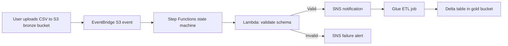

# Step Functions Data Processing Demo

This project is a small AWS pipeline built around S3, Lambda, Step Functions, Glue, and SNS. It was designed to show how a file uploaded to S3 can trigger a workflow, validate its structure, and land the cleaned data into a table for downstream use.

## What it does

1. A CSV is uploaded to the bronze S3 bucket.
2. An EventBridge rule listens for that S3 event and starts the Step Functions state machine.
3. The state machine calls a Lambda function with the bucket and object key.
4. The Lambda reads the file, checks the expected columns, and returns a schema validation result.
5. If the schema is valid, it sends an SNS notification and starts a Glue job.
6. The Glue job reads the CSV using a strict schema and merges it into a Delta table stored in the gold bucket.
7. If the schema is wrong, the workflow sends a different SNS message and stops.

## Architecture at a glance

- S3 bronze bucket: raw landing zone
- S3 gold bucket: final processed data storage
- Lambda: schema validation and file inspection
- Step Functions: orchestration layer
- Glue ETL job: Spark-based merge into Delta table
- SNS topic: email notifications for success/failure states

## How to create this project

1. Deploy the stack in `project.yml` with CloudFormation.
   - This creates the bronze S3 bucket, gold S3 bucket, Lambda, IAM role, SNS topic, and Glue job.
2. Update the Lambda code in the AWS console.
   - Copy the contents of `lambda_handler.py` into the `fileprocessorlambda` function.
3. Create the required folder structure in the bronze bucket.
   - Create `spark_code/` and upload `glue_code.py`.
   - Create `user_input/` for incoming CSV files.
4. Create the Step Functions state machine.
   - Name it `fileProcessor`.
   - Use the workflow from `step_function_code.json` to wire the Lambda, SNS, and Glue stages.
5. Add an EventBridge rule on the default bus.
   - Target the S3 bucket and specific prefix so uploads trigger the workflow.
6. Upload a test CSV, such as `sample_data_1000.csv`.
   - This should trigger the full flow and produce the expected SNS messages and Glue output.
7. Check the processed result in the gold bucket and Athena.
   - Create an `athena_output` folder in the bronze bucket if you want to query the merged data through Athena.

## Key files

- `project.yml` — CloudFormation stack definition for S3 buckets, Lambda, IAM role, SNS, and Glue job.
- `step_function_code.json` — Step Functions workflow definition.
- `lambda_handler.py` — reads the uploaded CSV and validates column names.
- `glue_code.py` — Spark + Delta logic to read files and merge into `stepfunctions.stepfunctiontable`.
- `sample_data_1000.csv` — sample input used to test the flow.

## Expected schema

The Lambda validates the following columns:

- `name`
- `age`
- `email`
- `is_active`

If any of these are missing, the workflow treats the file as invalid.

## Typical run flow

- Upload a CSV to `s3bronzestepfucntionsdemo/user_input/`
- EventBridge triggers the `fileProcessor` state machine
- Lambda validates the file
- Valid records move to a Delta table in the gold bucket
- SNS sends email notifications for the result

## Useful notes

- The event rule should be scoped to the target bucket and folder prefix to keep the workflow focused.
- The Glue job writes to a Delta table in the `stepfunctions` catalog database.
- This is a good example of a lightly automated data pipeline where quality gates happen before the data lands in the curated layer.

## Why this project is useful

It brings together the basic AWS building blocks for a data processing workflow in one place: event-triggered orchestration, lightweight validation, and data transformation in a Spark-based job. It is a practical reference for learning how a real-world ingestion pipeline can be structured without building a full production platform.
